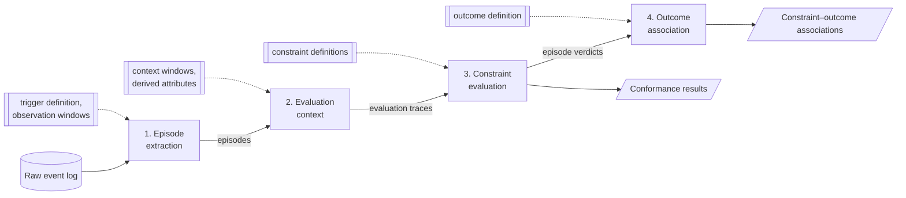

# Trigger-Based Declarative Conformance Checking

Code for the master's thesis *Trigger-Based Declarative Conformance Checking* (Duygu Mustafa,
Chair of Process and Data Science, RWTH Aachen University).

The thesis proposes a declarative, multi-perspective conformance checking framework. Normative
rules are MP-Declare constraints over control flow, data and time. Instead of evaluating whole
traces, the framework splits each case into **episodes** opened by a trigger event and checks every
episode on its own. It also adds a **target-selection** mode for repeatedly recorded measurements:
the verdict depends on the most recent measurement in the time window, not on any measurement that
happens to satisfy the condition. The framework is applied to weaning from mechanical ventilation in
the ICU, using event logs derived from MIMIC-IV, and evaluated on synthetic logs and on the public
Road Traffic Fine Management log.

This README covers the framework overview and the **Clinician Studio**, the interactive front end.
To rebuild the event log and the results from MIMIC-IV, see [docs/PIPELINE.md](docs/PIPELINE.md).

## Framework overview



The pipeline has four steps. Domain knowledge comes in only through configuration (dashed boxes), so
moving the framework to a new domain means writing new configuration, not changing the method.

| Step | What it does | Implementation |
|---|---|---|
| 1. Episode extraction | Splits each case trace into episodes. Each episode opens at a trigger event (`InvasiveVentilationStarted`) and ends at the next trigger, at a fixed observation window, or at an end event. | `main.py` (`_build_trigger_episodes`) |
| 2. Evaluation context | Extends each episode, per constraint, into the trace that constraint may see (`context_window_pre_hours` / `context_window_post_hours`). Derived attributes such as `hours_since_intubation` are also computed here. | `main.py` (`_process_stay`), `conformance/checker.py` (`_build_eval_context`) |
| 3. Constraint evaluation | Checks every evaluation trace against the MP-Declare constraints (24 templates, activation and correlation conditions, time windows, target selection *any / earliest / latest*). Each activation is classified as fulfilled or violated, and the constraint as satisfied, violated or vacuous. | `conformance/checker.py`, rules in `configs/declare/*.yaml` |
| 4. Outcome association | Relates episode verdicts to the episode outcome (SBT success/failure, or the next episode's outcome for inter-episode rules): Fisher's exact test, odds ratio, risk ratio. | `statistics_R.r`, `derive/statistical_analysis.py` |

For the ICU case, building the event log from MIMIC-IV is a separate preprocessing step outside the
method (`database/`, `prepare_event_log.py`, `derive/`).

## Clinician Studio

The Clinician Studio is a React app (`frontend/`) backed by a FastAPI server (`api.py`). In it you can
browse the clinical rule set, write new rules, run conformance checks, and explore the results.

### Prerequisites

- Python 3.14 and Node.js 18+
- Python dependencies: `python -m venv .venv && source .venv/bin/activate && pip install -r requirements.txt`
- Frontend dependencies: `cd frontend && npm install`

### Start

Start two processes from the repository root:

```bash
# Terminal 1: API backend (http://localhost:8000)
source .venv/bin/activate
uvicorn api:app --reload --port 8000
```

```bash
# Terminal 2: frontend dev server (http://localhost:5173); proxies /api/* to port 8000
cd frontend
npm run dev
```

Then open **http://localhost:5173**. For a production build, run `npm run build` (the output goes to
`frontend/dist/`) and then `npm run preview`.

### Pages

The sidebar has a **Dataset** selector: the built-in *ICU Weaning* dataset or an uploaded XES log.

| Group | Page | What it shows |
|---|---|---|
| Configure | **Upload Log** | Upload an XES event log and check your own rules on it, independently of the ICU pipeline. |
| Configure | **Rule Library** | The clinical rule set as Declare diagrams, with data conditions, time windows and severity scores. Built-in dataset only. |
| Configure | **Rule Builder** | A step-by-step wizard for writing a custom rule: template, events, time window, data conditions, metadata. It shows a live preview. Rules are saved in the browser's `localStorage`. |
| Analyze | **Run Analysis** | Run conformance on a random sample of stays (or of the uploaded log), with the predefined rules, your own rules, or both. |
| Results | **Frequencies** | Violations ranked by frequency, with timing histograms and drill-down per episode. |
| Results | **Statistics** | Associations between each constraint and the outcome: OR, RR, 95% CI, p-values. |
| Results | **Patients** | Browse and filter stays by violation profile, and open a per-stay timeline. |
| Results | **Insights** | Case-study views: deviation breadth, readiness violation causes, co-violation, attempt position. |

### Data each page needs

The repository contains no patient data. MIMIC-IV is credentialed-access, so you have to generate the
data files yourself:

| Feature | Needs |
|---|---|
| Upload Log, Rule Builder, Rule Library | Nothing beyond the repository. |
| Results pages (Frequencies, Statistics, Patients) | `frontend/public/data/` (`summary.json`, `manifest.json`, `case_*.json`), written by `main.py`. |
| Insights page | `frontend/public/data/insights.json`, written by `case_study/10_frontend_insights.py`. |
| Run Analysis on the built-in dataset | `data/icu_event_log_sample.parquet`, a sampled event log: `python prepare_event_log.py --sample-size 1000 --output data/icu_event_log_sample.parquet`. |
| Item search, SQL preview, custom MIMIC events in the Rule Builder | A PostgreSQL connection to MIMIC-IV (`MIMIC_DB_*` environment variables, see `database/client.py`). |

See [docs/PIPELINE.md](docs/PIPELINE.md) for how to produce these files.

**Run Analysis** is a quick, approximate run. Each episode is checked as a whole, without the
per-constraint context windows, and the outcome is recomputed from re-ventilation alone (the
death-within-48 h rule is not applied). The results pages and the thesis use the full pipeline
(`main.py`). The Studio hides rule `SBT-TM-02` (`DISABLED_RULE_IDS` in `api.py`); the
pipeline still evaluates it.

## Repository layout

| Path | Contents |
|---|---|
| `api.py`, `frontend/` | Clinician Studio backend and front end |
| `main.py` | Episode segmentation, constraint evaluation, statistics and frontend export |
| `prepare_event_log.py`, `derive/` | Raw MIMIC-IV rows → canonical event log (SBT and ventilation derivation, activity mapping) |
| `conformance/` | MP-Declare checker, YAML rule loader, types; optional weighted (Sugeno) scoring |
| `database/` | MIMIC-IV extraction from PostgreSQL |
| `configs/` | Activity mapping, item dictionary, Declare rule sets, importance weights |
| `statistics_R.r` | Outcome-association statistics (called by `main.py`) |
| `case_study/` | Scripts behind the MIMIC-IV case-study chapter, see [case_study/README.md](case_study/README.md) |
| `evaluation/` | Synthetic ground truth, Road Traffic Fine log, scalability benchmarks, see [evaluation/README.md](evaluation/README.md) |
| `tests/` | Unit and pipeline sanity tests (`python -m pytest tests/`) |
| `scripts/` | tmux/nohup launchers for long runs |
| `experimental/` | Code the pipeline does not use (alternative automata engine), see [experimental/README.md](experimental/README.md) |

## Further documentation

- [docs/PIPELINE.md](docs/PIPELINE.md): MIMIC-IV extraction, event-log construction, conformance
  run, outputs, rule format, API reference
- [case_study/README.md](case_study/README.md): regenerating the case-study results
- [evaluation/README.md](evaluation/README.md): synthetic and public-log evaluation, benchmarks
